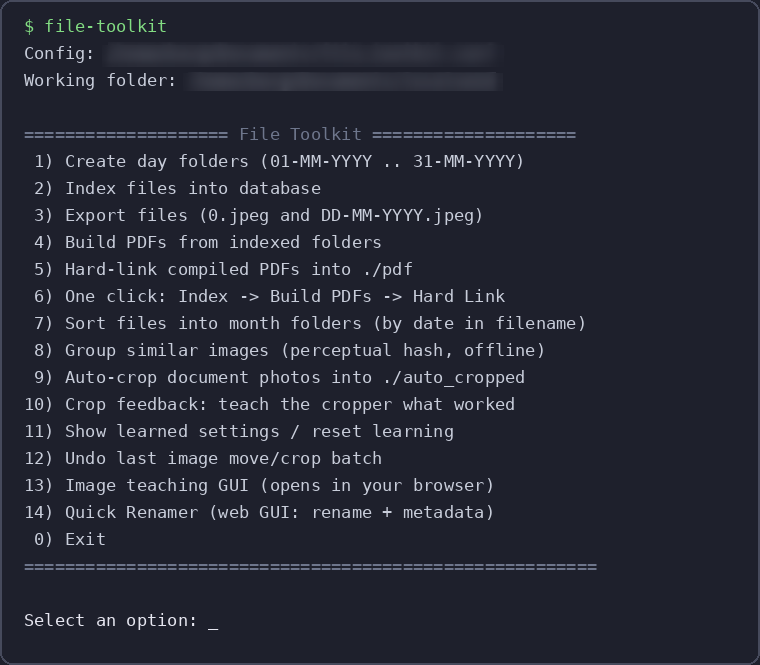
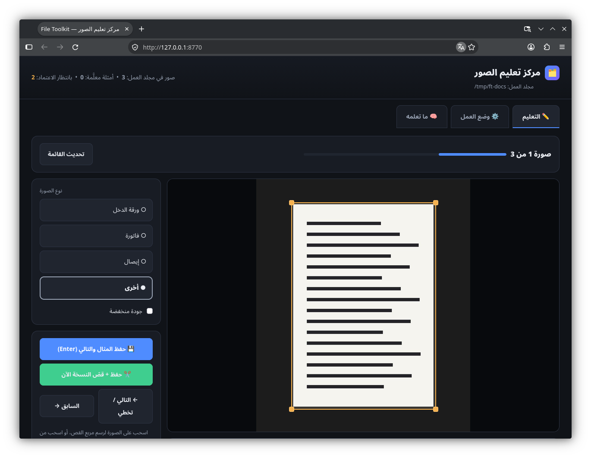
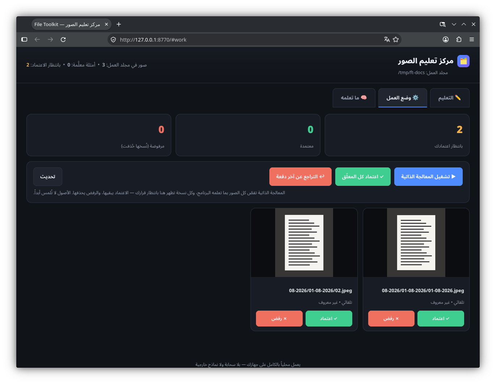
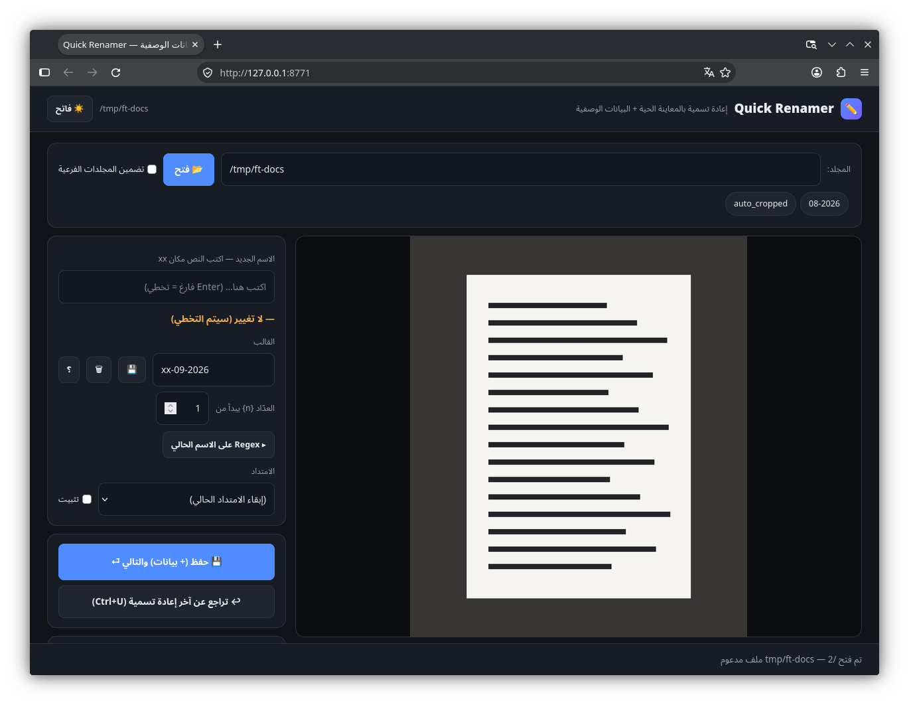

# 🗂️ File Toolkit

أداة واحدة لتنظيم صورك ومستنداتك: فرز الصور المتشابهة، قصّ المستندات تلقائياً،
تعليم البرنامج كيف يقصّ، إعادة تسمية بالمعاينة الحية، وتجميع المجلدات في PDF —
**كل شيء يعمل محلياً على جهازك، مجاناً وبلا سحابة أو نماذج خارجية.**



## التثبيت (بـ uv)

```bash
git clone https://github.com/WissamZa/file-toolkit.git
cd file-toolkit
uv sync
uv run file_toolkit.py
```

أو ثبّته لتعمل من أي مكان: `./install.sh` ثم اكتب `file-toolkit` في أي مجلد.

---

## الاستخدام المبسّط

### 1️⃣ تنظيم المجلدات والـPDF (الخيارات 1–7)

أنشئ مجلدات يومية لشهر معين، افتر الملفات حسب التاريخ المكتوب في أسمائها
(`01-08-2026.jpg` ← مجلد `08-2026`)، وجمّع كل مجلد في PDF واحد — كلها من القائمة
بالترتيب الذي يناسبك.

### 2️⃣ فرز الصور المتشابهة (الخيار 8)

يعرض البرنامج خطة كاملة: كل مجموعة صور متشابهة وأين ستُنقل — **ولا ينقل شيئاً
حتى تختار أنت** أرقام المجموعات (مثلاً `1,3-5` أو `a` للكل أو Enter للإلغاء).
الصور المختارة تذهب إلى `similar_review/` للمراجعة اليدوية.

### 3️⃣ القصّ التلقائي للمستندات (الخيار 9)

يكشف الورقة في كل صورة **مهما كانت أبعادها** (صور الجوال تختلف مقاساتها وزواياها) ويحفظ
نسخة نظيفة في `auto_cropped/` — **الأصل لا يُمس أبداً**. الصور المقصوصة أصلاً تُتخطى تلقائياً.

- **قبل وبعد:** عند الانتهاء يُنشأ تقرير `auto_cropped/_review/index.html` يعرض لكل صورة
  الأصل مع إطار حدود القص بجانب النتيجة، **والمشكوك فيه أولاً** (إطار برتقالي).
- **درجة ثقة** لكل قص + تنبيهات (ورقة مقطوعة، ثقة منخفضة، ميل…) — ما يقلّ عن 70٪ يحتاج نظرتك.
- سؤال اختياري: **تعديل ميل الورقة** (تدوير الورقة المائلة لتصبح مستقيمة).

### 4️⃣ علّم البرنامج ثم اعتمد أعماله (الخيار 13)

افتح واجهة التعليم في المتصفح:



- اسحب مربع القص الصحيح على الصورة، واختر نوعها (ورقة الدخل / فاتورة / إيصال).
- من تبويب **وضع العمل** شغّل المعالجة الذاتية: يقصّ البرنامج كل الصور بما تعلمه
  ويعرض النتائج **بانتظار اعتمادك** — تعتمد فتبقى، أو ترفض فتُحذف:



- أثناء التعليم تظهر **معاينة «بعد القص» حيّة** مع الكشف التلقائي (خط أزرق متقطّع) ودرجة الثقة،
  ويعمل السحب بالفأرة وباللمس.
- في وضع العمل كل نتيجة تُعرض **قبل/بعد** (اضغط للتكبير)، والمشكوك فيها بإطار برتقالي، مع أزرار
  «اعتماد الموثوق فقط» و«⚠ تحتاج مراجعة».

**كيف يتعلّم دون ربطه بأبعاد الصورة؟** كل مثال تعلّمه يُحفظ بنِسَب نسبية ويُقارَن بما كشفه البرنامج
نفسه، فيتعلّم *كم تحب أن يكون الهامش حول الورقة* (كنسبة من ضلع الصورة) ويطبّقه على أي صورة بأي حجم.
المثال المعلَّم يُستخدم مباشرةً كقص ثابت فقط إذا تطابقت 3 أمثلة أو أكثر لنفس شكل الصورة
(كلقطات الشاشة)، أو احتياطاً إذا لم تُكشف ورقة.

**اختبار الدقّة بنفسك:** `python crop_selftest.py` يولّد صور جوال مصطنعة (أحجام/ظلال/ميل/منظور/
ورقة مقطوعة…) ويقيس الدقة ويحفظ صور قبل/بعد في `selftest_out/`.
`python crop_selftest.py --photos مجلد_صورك` يُنتج صور قبل/بعد لصورك الحقيقية.

### 🧠 التعلّم الحقيقي من أمثلتك (الأهم لصور الفواتير)

كاشف الألوان وحده لا يستطيع إيجاد فاتورة بيضاء على رخام أبيض بجانب أوراق فارغة وآلة حاسبة. لذلك
يتدرّب البرنامج على **الصناديق التي ترسمها أنت** في واجهة التعليم (الخيار 13): نموذج صغير
(غابة قرارات بـnumpy، بلا اعتماديات جديدة) يتعلّم من اللون والنسيج وكثافة الحبر والموضع ثم
يتوقّع الفاتورة في أي صورة جديدة بأي حجم.

- يبدأ التعلّم بعد **3 صور معلَّمة**؛ يعمل جيداً بعد ~8–10، وكل صورة تصحّحها وتحفظها تحسّنه
  (يتدرّب تلقائياً في الخلفية ~4 ثوانٍ).
- في وضع العمل تظهر النتائج غير المؤكدة **أولاً بإطار برتقالي** — صحّحها من تبويب التعليم.
- تبويب «ما تعلمه» ← **قياس الدقة**: يختبر النموذج على صور لم يرها ويعرض نسبة التطابق مع صناديقك.
- لبداية سريعة مع صور WhatsApp المرفقة: `python import_boxes.py` يستورد `starter_boxes.json`
  (صناديق تقريبية ±30 بكسل لـ20 صورة، ضعها في مجلد العمل أولاً) ثم يدرّب النموذج.

### 🏷️ نوع الملف في إعادة التسمية السريعة (ورقة الدخل / فاتورة)

اختيار أعلى خانة الاسم (أو `Alt+1` / `Alt+2`) ويُحفظ بين الجلسات:

- **ورقة الدخل:** ملف واحد لكل تاريخ بالاسم العادي، مثل `15-09-2026`.
- **فاتورة:** يُضاف `-n` في آخر الاسم: `15-09-2026-1` ثم `-2` ثم `-3`. يبدأ العدّ من 1 لكل
  تاريخ جديد، وإذا عدتَ لتاريخ موجود في المجلد يكمل من آخر رقم (أعلى رقم + 1، فلا تتصادم
  الأرقام حتى لو حُذف ملف في المنتصف). حفظ فاتورة مرقّمة مرة أخرى لا يغيّر رقمها، وتغيير
  الامتداد فقط لا يضيف رقماً. ولو كان القالب يحتوي `{n}` يُترك كما هو.
- بعد **Enter** تُمسح خانة النص ويعود المؤشّر إليها للملف التالي (كان الإصدار الويب يُبقي النص).
- يعمل الترقيم نفسه في **إعادة التسمية الجماعية** (تسلسلي لكل تاريخ)، وتُعلَّم الأسماء
  المكررة داخل الدفعة كتعارض.

### 5️⃣ إعادة التسمية بالمعاينة الحية (الخيار 14)



قوالب جاهزة (`{orig}`, `{n:03}`, `{date}`, `{mtime}` أو اكتب مكان `xx`)، بحث
واستبدال بالـRegex، تغيير الامتداد، وتعديل البيانات الوصفية لـPDF/EXIF/PNG —
معالقة تعارضات وتراجع بضغطة. وكل ذلك متاح أيضاً **جماعياً**: تطبيق القالب على
كل ملفات المجلد دفعة واحدة مع جدول معاينة (القديم ← الجديد) قبل التنفيذ وتراجع
جماعي بضغطة.

### 6️⃣ التراجع عن أي شيء (الخيار 12)

كل نقل وقصّ وإعادة تسمية يُسجَّل في قاعدة البيانات — الخيار 12 يلغي آخر دفعة
كاملة ويعيد كل ملف لمكانه الأصلي.

---

## كيف يتعلم البرنامج؟

كل إجابة تعطيها (مجموعة ليست متشابهة، قصّ ضيق جداً، اعتماد…) تُسجَّل وتعدّل
المعاملات تلقائياً ضمن حدود آمنة. الخيار 11 يعرض ما تعلمه البرنامج ويعيد ضبطه.

## الإعدادات (اختيارية)

ملف `file_toolkit.conf` يحدد مجلد العمل ومواضع المخرجات:

```ini
[settings]
folder = /home/barg/Documents/localsend   ; مجلد العمل
database = files.db
similar_review = similar_review           ; مجلد مراجعة المتشابهات
cropped_output = auto_cropped             ; النسخ المقصوصة
```

## المتطلبات

Python 3.9+ فقط — والباقي يتولاه `uv sync` (reportlab, pypdf, Pillow,
imagehash, numpy, PyMuPDF, piexif). الواجهات الرسومية تعمل في المتصفح بلا
أي متطلبات إضافية.

## الترخيص

MIT
